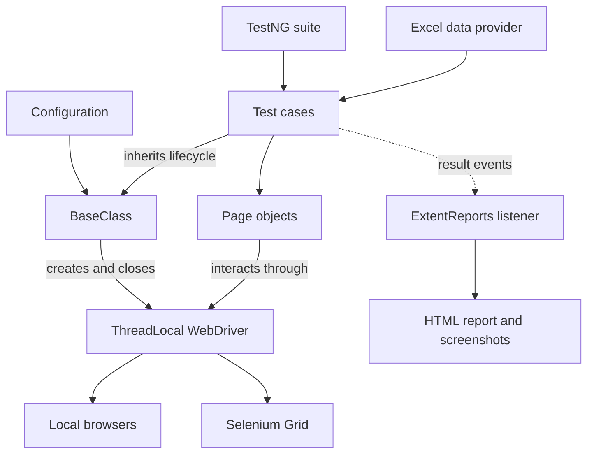

EcommerceHub:
==============
Hybrid Test Automation Framework:
=================================
Reusable page objects. Data-driven tests. Cross-browser execution.

A Java and Selenium framework for testing the CloudBerry Store shopping experience—from sign-in and product selection to checkout and order confirmation.

Getting Started · Architecture · Test Coverage · Running Tests · Reports
=========================================================================

Overview:
===========
EcommerceHubV7 brings together the Page Object Model (POM), Excel-driven testing, and reusable test utilities in a hybrid UI automation framework. 
Test scenarios describe user workflows, page objects encapsulate browser interactions, and shared components handle browser setup, reporting, screenshots, logging, and retries.

The framework targets CloudBerry Store and supports Chrome, Firefox, and Edge through local WebDriver sessions or Selenium Grid.

Framework Highlights:
======================
Capability	                    Implementation
Page Object Model	              Page classes use @FindBy locators and Selenium PageFactory initialization.
Data-driven login	              Apache POI reads credentials from Excel and supplies them through a TestNG @DataProvider.
Cross-browser testing	          Chrome, Firefox, and Edge are configured as separate TestNG test blocks.
Parallel execution	            The supplied suite uses parallel="tests"; browser drivers are stored in ThreadLocal<WebDriver>.
Local and remote execution	    execution_env selects local browser sessions or RemoteWebDriver through Selenium Grid.
HTML reporting	                An ExtentReports listener records results, test groups, environment information, and failure screenshots.
Diagnostic logging	            Log4j2 writes execution details to a rolling log file.
Retry handling	                RetryAnalyzer permits up to two retries for annotated tests.
Suite organization	            TestNG groups support sanity, regression, and datadriven selections.

Architecture:
=============

**Test layer:** Defines workflows and assertions in testCases.
**Page layer:** Encapsulates locators and page actions in pageObjects.
**Execution layer:** Loads configuration and manages class-level browser setup and teardown in BaseClass.
**Utility layer:** Provides Excel access, test data, retry behavior, and reporting.

Technology Stack:
=================
Versions below reflect the declarations in [`pom.xml`](pom.xml)

Technology	              Version	                      Purpose
----------------------------------------------------------------------------------------
Selenium WebDriver	       4.51.0	                Browser automation and remote sessions
TestNG	                   7.12.0	                Tests, assertions, groups, listeners, and data providers
ExtentReports	             5.1.2	                Spark HTML reports
Apache POI / POI OOXML	   6.0.0	                Excel workbook access
Log4j2	                   2.26.1	                Execution logging
Maven Compiler Plugin	     3.16.0	                Java compilation
Maven Surefire Plugin	     3.5.4	                TestNG suite execution through Maven
Apache Commons Email	     1.6.0	                Dependency for the commented-out email reporting example

Project Structure:
====================
Location	                                                                            Responsibility
----------------------------------------------------------------------------------------------------------------------------------------
[`src/test/java/pageObjects/`](src/test/java/pageObjects/)	                          BasePage and page objects for home, login, account, category, product, checkout, confirmation, and affiliate workflows
[`src/test/java/testCases/`](src/test/java/testCases/)	                              Seven test classes covering six functional areas, including two login approaches
[`src/test/java/testBase/BaseClass.java`](src/test/java/testBase/BaseClass.java)	    Configuration loading, local/Grid driver creation, teardown, and screenshot capture
[`src/test/java/utilities/`](src/test/java/utilities/)	                              DataProviders, ExcelUtility, ExtentReportManager, and RetryAnalyzer
[`src/test/resources/config.properties`](src/test/resources/config.properties)	      Application URL and execution environment
[`src/test/resources/log4j2.xml`](src/test/resources/log4j2.xml)	                    Logging configuration
[`testData/EcommerceHubDataSheet.xlsx`](testData/EcommerceHubDataSheet.xlsx)	        Login test data
[`testng.xml`](testng.xml)	                                                          Browser parameters, groups, listener, classes, and parallel settings
[`pom.xml`](pom.xml)	                                                                Maven dependencies and build plugin configuration
reports/	                                                                            ExtentReports HTML output
screenshots/	                                                                        Captured failure images
logs/	                                                                                Current and archived execution logs
target/surefire-reports/	                                                            Test results produced by Maven Surefire

Test Coverage:
==============
Test class	                        Scenario and assertion	                                                                                  Groups
--------------------------------------------------------------------------------------------------------------------------------------------------------------
TC01_LaunchApplication	            Open the application and verify the page title.	                                                          sanity, regression
TC02_Login	                        Sign in and verify the My Account heading.	                                                              sanity, regression
TC02_Login2_DataDriven	            Repeat login for Excel credential rows, verify My Account, and log out after a successful login.	        sanity, regression, datadriven
TC03_AddToCart	                    Select HP LP3065, set a delivery date, add it to the cart, and verify the success message.	              sanity, regression
TC04_CompletePurchase	              Add a product, sign in during checkout, select shipping/payment options, and verify order confirmation.	  sanity, regression
TC05_AddToWishList	                Sign in, add a product to the wishlist, and verify the success message.	                                    regression
TC06_AddAffiliate	                  Sign in, submit affiliate details, and verify the success message.	                                        regression

**Coverage note:** The data-driven login test currently expects every supplied credential pair to sign in successfully. Invalid-login assertions would require a separate negative test or an expected-result column with matching test logic.
**Getting Started**
**1. Prepare your environment**
- A JDK 17 or newer; the commands below explicitly target Java 17.
- Maven 3.9.x and Git available on your PATH.
- Chrome, Firefox, and/or Edge installed for the browsers selected in your suite.
- Network access to Maven dependencies and the application under test.
- An IDE such as Eclipse or IntelliJ IDEA, if you prefer running tests interactively.
Check your tools:
java -version
mvn -version
git --version
The committed Eclipse settings reference Java 8, while pom.xml does not explicitly set a Java release. Update the IDE's JDK/compiler settings to match your chosen modern JDK. The Maven commands below supply the release explicitly.
**2. Clone the repository**
git clone https://github.com/Elakiya1505/EcommerceHubV7.git
cd EcommerceHubV7
Ensure the reports, screenshots, and logs directories exist. On macOS/Linux:
mkdir -p reports screenshots logs
On Windows, create the same folders using your IDE or File Explorer if needed. Screenshot capture expects its destination directory to exist.
**3. Select local execution**
Edit [`src/test/resources/config.properties`](src/test/resources/config.properties):
appURL=https://cloudberrystore.services/
execution_env=local
Keep exactly one active execution_env entry. The repository currently defaults to remote, which requires a running Selenium Grid.
**4. Prepare the test accounts**
Use dedicated test accounts for the target environment:
- Update the credentials currently embedded in TC02_Login, TC04_CompletePurchase, TC05_AddToWishList, and TC06_AddAffiliate.
- Populate the login workbook with valid test credentials, following the Excel format.
- For checkout, ensure the selected account has a saved shipping address and that the expected shipping/payment options are available.
- Ensure HP LP3065 is available in the catalog.
Keep real passwords and personal account details out of committed files. Credentials are not currently loaded from config.properties or environment variables; adding that behavior requires a code change.

The full suite places test orders and updates wishlist/affiliate information. Run it against your intended test environment.
**5. Compile the tests**
From the repository root:
mvn test-compile -Dmaven.compiler.release=17

This resolves dependencies and compiles the test sources without launching the browser suite.

Configuration:
===============
Setting	                    Location	                    Current behavior
---------------------------------------------------------------------------------------------------------------------------
appURL	                    config.properties	            URL opened by BaseClass and reused by several tests
execution_env	              config.properties	            local or remote; committed value is remote
browser	                    testng.xml	                  chrome, firefox, or edge
os	                        testng.xml	                  All supplied blocks use mac; remote setup also accepts windows, mapped to Windows 11
gridURL	                    BaseClass.java	              Hard-coded as http://localhost:4444/wd/hub
parallel / thread-count	    testng.xml	                  tests / 5, with three browser test blocks
maxRetryCount	              RetryAnalyzer.java	          2 additional attempts

appURL2 and appURL3 are present in the properties file but are not used by the current test setup. The os parameter selects a platform for remote execution; local execution uses the host machine.

Running Tests:
================
**Full browser suite**
After preparing the environment and accounts:
mvn clean test -Dmaven.compiler.release=17

Surefire reads the configured testng.xml. The supplied suite includes all seven classes under each of the Chrome, Firefox, and Edge blocks, with browser blocks eligible to run concurrently.

**First run: a single-browser smoke test**
Create testng-smoke.xml in the repository root using this example. It runs only the application launch test on Chrome:
<?xml version="1.0" encoding="UTF-8"?>
<!DOCTYPE suite SYSTEM "https://testng.org/testng-1.0.dtd">
<suite name="EcommerceHub Smoke Suite">
    <listeners>
        <listener class-name="utilities.ExtentReportManager"/>
    </listeners>
    <test name="Chrome Smoke">
        <parameter name="os" value="mac"/>
        <parameter name="browser" value="chrome"/>
        <classes>
            <class name="testCases.TC01_LaunchApplication"/>
        </classes>
    </test>
</suite>
              
**Run the custom suite:**
mvn clean test -Dmaven.compiler.release=17 -Dsurefire.suiteXmlFiles=testng-smoke.xml
Change the browser parameter to firefox or edge as needed. 
For remote execution, set os to match an available Grid node. 
Add other test classes to this suite to run a focused selection while retaining the listener and required parameters.
**Select a TestNG group**
In testng.xml, replace the existing <groups> block with the group selection you want. For example:
<groups>
    <run>
        <include name="sanity"/>
    </run>
</groups>
Then run the full-suite Maven command. Use regression or datadriven for the other selections. 
The current sanity group includes checkout and Excel-driven login; use the smoke suite above for a launch-only check.

**Run from an IDE**
Import the project as an existing Maven project, select the appropriate JDK, and refresh Maven dependencies. 
In Eclipse with TestNG support installed, right-click testng.xml and select Run As → TestNG Suite. 
In other IDEs, use the equivalent TestNG suite runner.
**Selenium Grid Execution**
1. Start a Selenium Grid with the browsers and platforms required by your suite. See the official Grid setup guide.
2. Confirm that the Grid is reachable at http://localhost:4444, or use your Grid host.
3. Set execution_env=remote in config.properties.
4. If the Grid runs elsewhere, update gridURL in BaseClass.java.
5. Match each suite's browser and os parameters to the available nodes, then run the Maven test command.
The current remote platform selection handles mac and windows. Add a Linux branch in BaseClass before using Linux Grid nodes, including typical Linux-based browser containers.
**Excel Test Data**
Workbook: [`testData/EcommerceHubDataSheet.xlsx`](testData/EcommerceHubDataSheet.xlsx)
Worksheet: Sheet1
Provider: LoginData in utilities.DataProviders

Keep the first row as headers and use exactly two columns in this order:
username	password
qa.user1@example.com	REPLACE_WITH_TEST_PASSWORD
qa.user2@example.com	REPLACE_WITH_TEST_PASSWORD

These are format examples; replace them with valid test accounts. DataProviders skips the header, reads the remaining rows using ExcelUtility, and passes each pair to testLogin(String email, String pwd). Keep rows complete and avoid additional columns unless the test method and provider are updated together.

Reports and Diagnostics:
=========================
Output	                          Location	                          What it contains
---------------------------------------------------------------------------------------------------------------
ExtentReports	          reports/Test-Report-<timestamp>.html	        Dark-theme HTML report with pass/fail/skip results, groups, environment metadata, and failure image references
Screenshots	            screenshots/<test-name>_<timestamp>.png	      Browser screenshots captured on failures; some tests also capture images directly
Execution log	          logs/automation.log	                          Detailed application and framework execution messages
Archived logs	          logs/automation-<date>-<index>.log.gz	        Log4j2 rolling log archives
Surefire results	      target/surefire-reports/	                    Test results generated by Maven execution

Open the latest HTML report in a browser. The listener also attempts to open it automatically through Java's Desktop API after execution. If automatic opening is unavailable, open the file manually. Keep the associated screenshots available: the listener attaches image file paths rather than embedding the image bytes.

<strong>Execution notes for parallel runs and CI</strong>
- Browser sessions use ThreadLocal, but ExtentReportManager uses shared mutable report fields and second-resolution report names. Concurrent test contexts can interfere with report output. Use a single test block for focused diagnostics; isolate report state and filenames before relying on consolidated parallel results.
- Browser setup and teardown occur per test class. A retry does not automatically create a fresh browser session or reset application data.
- The report-opening code assumes a desktop environment. Guard or disable that call for headless CI agents, and configure headless browser options if required.
- Email delivery code is commented out. No email is sent by the current listener.
- The repository does not currently include a Jenkinsfile, GitHub Actions workflow, or Docker configuration.

Troubleshooting:
================
Symptom	                                                        What to check
----------------------------------------------------------------------------------------------------------------------
Connection refused at port 4444	                      Use execution_env=local, or start the Grid and check gridURL.
Remote session cannot be created	                    Match browser/platform capabilities to an available Grid node.
Browser fails to start locally	                      Verify browser installation, driver compatibility, and any network/proxy restrictions on driver resolution.
Required os or browser parameter is missing	          Run through a TestNG XML suite that supplies both parameters.
Excel file or sheet cannot be found	                  Run from the repository root and preserve the workbook path and Sheet1 name.
Data-provider parameter mismatch	                    Keep exactly two populated columns per data row, matching the login test method.
Login or checkout fails	                              Verify test credentials, account state, saved shipping address, product availability, and current page locators.
Failure screenshots are missing	                      Ensure screenshots/ exists and is writable; inspect the log and verify the screenshot file was actually created.
Report does not open, or a Desktop exception occurs	  Open the HTML file manually; guard/disable automatic opening on headless machines.
IDE reports Java compatibility errors	                Update the committed Java 8 IDE settings to match your chosen JDK and refresh Maven dependencies.

Extending the Framework:
=========================
1. Add or update a class in pageObjects, extending BasePage and passing the driver to super(driver).
2. Keep page locators and reusable interactions in that page class.
3. Add a test in testCases that extends BaseClass, obtains the driver through getDriver(), and asserts the expected result.
4. Assign suitable TestNG groups and attach RetryAnalyzer where appropriate.
5. Register the new class in the relevant XML suite and add any required test data.
6. Review the resulting report, screenshots, and log output.
Potential next improvements include externalized credentials and Grid settings, explicit waits in place of fixed sleeps,
negative login coverage, isolated parallel reporting, and a CI workflow with retained test artifacts.

Maintained by Elakiya1505
View Repository · Report an Issue
